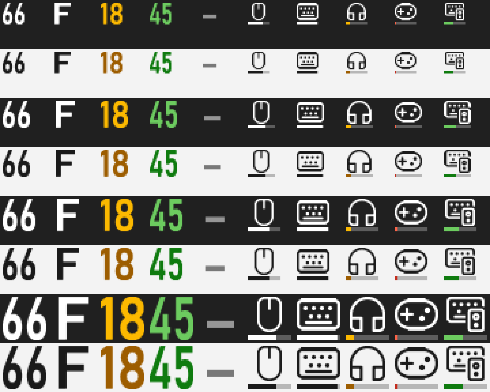

# Voltray

**Battery levels for all your wireless peripherals, right in the Windows system tray.**

Voltray shows the battery of your mouse, keyboard, headphones, earbuds and controllers next to the Windows clock, with one icon per device category. It is a small native background app with no vendor software required.

> **Status: early development (v0.1.0-dev).** Logitech HID++ works and is tested on hardware. Bluetooth support is implemented but not yet verified with a real device ([help wanted](#device-support)). The settings window is next. See the [roadmap](#roadmap).



## Features

- **One icon per category** (mouse, keyboard, headphones, earbuds, controller, other). Two mice share the mouse icon, and the icon shows the lowest battery in the group.
- **Two icon styles:** the battery percentage, or the category symbol with a level bar. Colors change for low, critical and charging.
- **Hover** shows every device in the category with its level. **Click** opens a menu with the same list and the options.
- **Hide categories** you do not care about.
- **Coexists with vendor software.** Logitech devices are read directly over HID++, with or without G HUB running.
- **Tiny footprint:** ~3 MB single executable, ~5 MB private memory, ~0 % CPU when idle.

## Device support

Voltray only shows what a device reports. Some devices never report battery to the PC, and no software can read it from them.

| Source | Status | Notes |
|---|---|---|
| Logitech LIGHTSPEED / Unifying / Bolt receivers (HID++ 2.0) | ✅ Working | Exact percentage on newer devices (feature 0x1004). Estimated from voltage on older ones. Tested: PRO X Superlight 2. |
| Bluetooth Classic headsets (HFP) | 🧪 Implemented, untested | Same level Windows shows in Settings, pushed on change. |
| Bluetooth LE | 🧪 Implemented, untested | Windows-read level, or the GATT Battery Service with notifications as fallback. |
| Xbox controllers (GameInput) | 🗓 Planned | |
| DualSense / DualShock | 🗓 Planned | |
| Razer, SteelSeries, HyperX, Corsair | 🔬 Needs research | Proprietary protocols, one provider per vendor. |
| Generic 2.4 GHz dongles | ❌ Not possible | They do not send battery information. |

Your device is not detected? Run `HidppProbe.exe --list` (Logitech) or `BluetoothProbe.exe` (Bluetooth) and open a [device support issue](../../issues/new?template=device-support.yml). Bluetooth reports are especially welcome right now.

## Install

There is no release yet. Build from source:

```bash
git clone https://github.com/gabrielgua/voltray
cd voltray
dotnet publish src/Voltray -c Release -r win-x64 -o artifacts/publish/Voltray
```

Requirements: Windows 10 2004 (19041)+ or Windows 11, the [.NET 10 SDK](https://dotnet.microsoft.com/download), and the Visual Studio C++ build tools (for NativeAOT).

### Why is my icon hidden?

New tray icons go to the overflow (^) area by default. Windows leaves that choice to you, and Voltray does not override it. To pin an icon, open **Settings → Personalization → Taskbar → Other system tray icons** and turn Voltray on. Each category has its own entry, so you can pin the mouse icon and leave the others hidden.

## Architecture

```
Voltray.exe (background, Win32 + NativeAOT, ~5 MB)
 ├─ Providers ── Logitech HID++ · Bluetooth · ...   report devices + readings
 ├─ DeviceRegistry ── classification, user overrides, last-known state
 └─ TrayManager ── one icon per category, tooltips, menus

Voltray.Settings.exe (planned, WinUI 3, started on demand, exits when closed)
```

The settings UI runs as a separate process because WinUI 3 keeps ~100 MB in memory after its window closes. See [docs/architecture.md](docs/architecture.md) and the [phase 0 measurements](docs/phase0.md).

## Roadmap

- **v0.1:** Logitech HID++ ✅, Bluetooth HFP + BLE battery 🧪, low-battery notifications, start with Windows, settings window (dashboard, settings, about), releases on GitHub.
- **v0.2:** Xbox / GameInput, DualSense, 7-day history, device nicknames, diagnostics export.
- **v0.3:** Razer, SteelSeries, HyperX, Corsair providers.
- **Later:** rich hover cards, winget, code signing, localization (en / pt-BR), external provider plugins.

## Contributing

Contributions are welcome, especially new device providers and device reports. Read [CONTRIBUTING.md](CONTRIBUTING.md) and [docs/adding-a-provider.md](docs/adding-a-provider.md).

## License

[MIT](LICENSE). Voltray is not affiliated with Logitech or any other device manufacturer. Product names are trademarks of their owners.
