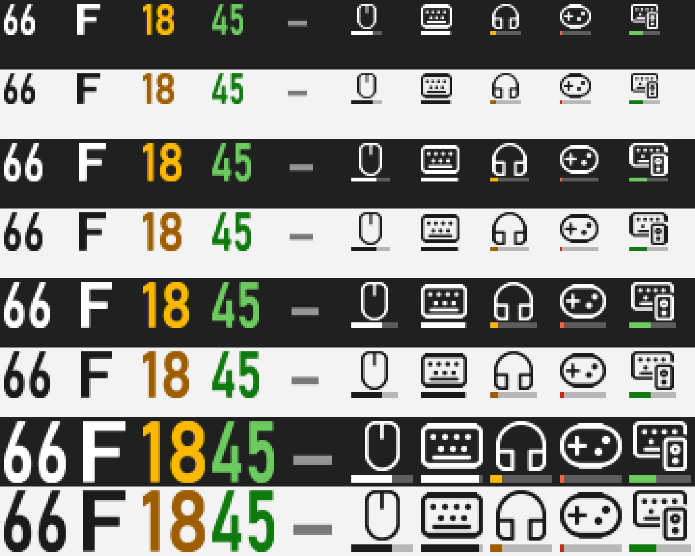
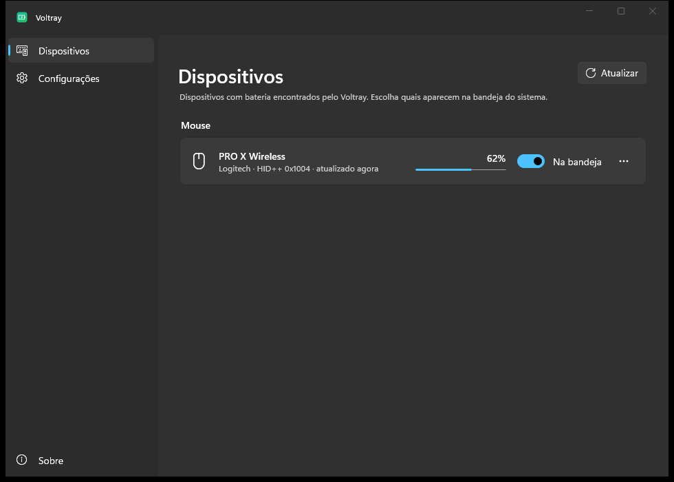
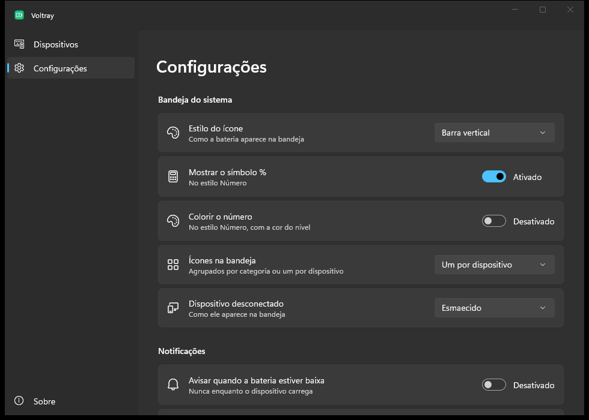
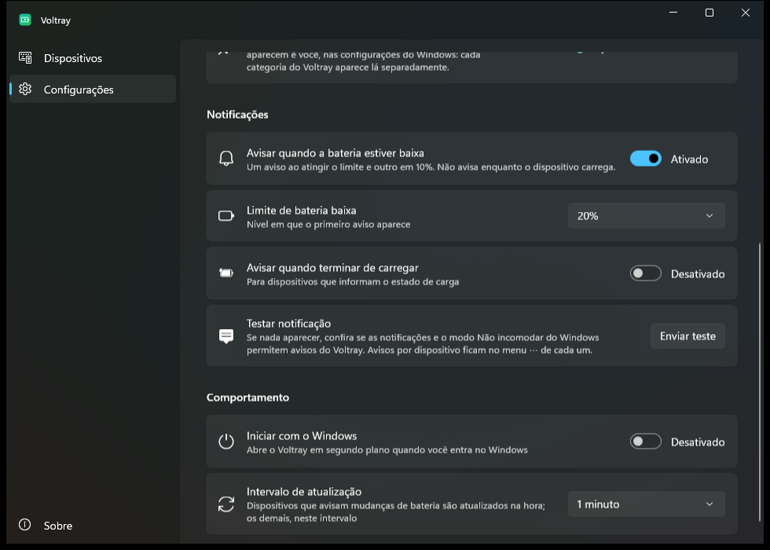

# Voltray

**Battery levels for all your wireless peripherals, right in the Windows system tray.**

Voltray shows the battery of your mouse, keyboard, headphones, earbuds and controllers next to the Windows clock: one icon per device category, or one per device. It is a small native background app with no vendor software required.

> **Status: early development ([v0.1.0](../../releases/latest)).** Logitech HID++ works and is tested on hardware. Bluetooth support is implemented but not yet verified with a real device ([help wanted](#device-support)). See the [roadmap](#roadmap).



| Devices | Settings | Notifications |
|---|---|---|
|  |  |  |

## Features

- **Tray icons that tell devices apart.** Every icon shows the device's symbol ([Hugeicons](https://hugeicons.com), stroke rounded). Choose one of four styles:
  - **Bar:** rounded level bar below the symbol.
  - **Vertical bar:** rounded level bar beside the symbol.
  - **Colored:** the symbol itself turns green, yellow, orange or red with the level.
  - **Number:** symbol on top, percentage below in a pixel font that stays readable at 16 px. The "%" sign and level-colored digits are optional.
- **Or on the taskbar itself:** instead of tray icons, the devices can be written on the taskbar next to the tray (symbol and percentage, optionally with a level bar, or two compact rows). Hovering opens the quick panel. Settings shows a picture of every option.
- **One icon per category or one per device.** Per category, two mice share the mouse icon and it shows the lowest battery. Per device, each one gets its own icon, and you can pick that icon from 22 symbols.
- **Disconnected devices** are hidden from the tray by default, or stay dimmed with their last level. They are always listed in the window.
- **Hover** shows the devices and their levels. **Left click** opens a quick panel above the tray: a tile per connected device, filled up to its battery level, on a blurred acrylic background. It opens instantly because the tray app draws it itself. **Right click** opens a quick menu (icon style, hide an icon, refresh).
- **Low-battery notifications:** any number of rules, each with its own limit and message, plus a test button. Each rule warns once per discharge; crossing several at once shows only the lowest. Never while charging. Optionally, a notice when charging completes. Each device can be muted. Windows Do Not Disturb, including the automatic mode during full-screen games, is respected.
- **Compact window** (Windows 11 style, light/dark, acrylic): one card per device whose background is the battery level, with a charging animation (Stream, Bubbles or Sparks). Per-device "show in tray", notifications, category and icon; settings for start with Windows, refresh interval and alerts.
- **Coexists with vendor software.** Logitech devices are read directly over HID++, with or without G HUB running.
- **Tiny footprint in the background:** ~5 MB executable, ~9 MB private memory, ~0 % CPU when idle. The settings window is a separate process that exits when closed.

## Device support

Voltray only shows what a device reports. Some devices never report battery to the PC, and no software can read it from them.

| Source | Status | Notes |
|---|---|---|
| Logitech LIGHTSPEED / Unifying / Bolt receivers (HID++ 2.0) | ✅ Working | Exact percentage on newer devices (feature 0x1004). Estimated from voltage on older ones. Tested: PRO X Superlight 2. |
| Titorion 2.4 GHz keyboards (receiver 056D:C077 / C088) | ✅ Working | Exact percentage and charging state, polled (the same read-only query as the vendor web app). |
| Bluetooth Classic headsets (HFP) | 🧪 Implemented, untested | Same level Windows shows in Settings, pushed on change. |
| Bluetooth LE | 🧪 Implemented, untested | Windows-read level, or the GATT Battery Service with notifications as fallback. |
| Xbox controllers (GameInput) | 🗓 Planned | |
| DualSense / DualShock | 🗓 Planned | |
| Razer, SteelSeries, HyperX, Corsair | 🔬 Needs research | Proprietary protocols, one provider per vendor. |
| Generic 2.4 GHz dongles | ❌ Not possible | They do not send battery information. |

Your device is not detected? Run `HidppProbe.exe --list` (Logitech) or `BluetoothProbe.exe` (Bluetooth) and open a [device support issue](../../issues/new?template=device-support.yml). Bluetooth reports are especially welcome right now.

## Install

Download the latest version from [Releases](../../releases/latest):

- **Voltray-x.y.z-setup.exe**: installer, for your user only (no admin rights). Adds a Start menu entry and can start Voltray with Windows.
- **Voltray-x.y.z-portable.zip**: extract anywhere and run `Voltray.exe` (keep the `settings` folder next to it).

The files are not code-signed yet: Windows SmartScreen may say "Windows protected your PC" the first time. Click **More info → Run anyway**.

### Build from source

```bash
git clone https://github.com/gabrielgua/voltray
cd voltray
dotnet publish src/Voltray -c Release -r win-x64 -o artifacts/publish/Voltray
dotnet publish src/Voltray.Settings -c Release -o artifacts/publish/Voltray/settings
```

Run `artifacts/publish/Voltray/Voltray.exe`. The `settings` folder must stay next to it.

Requirements to build: Windows 10 2004 (19041)+ or Windows 11, the [.NET 10 SDK](https://dotnet.microsoft.com/download), and the Visual Studio C++ build tools (for NativeAOT).

### Why is my icon hidden?

New tray icons go to the overflow (^) area by default. Windows leaves that choice to you, and Voltray does not override it. To pin an icon, open **Settings → Personalization → Taskbar → Other system tray icons** and turn Voltray on. Each Voltray icon (each category, or each device) has its own entry there.

## Architecture

```
Voltray.exe (background, Win32 + NativeAOT, ~5 MB)
 ├─ Providers ── Logitech HID++ · Titorion · Bluetooth · ...   report devices + readings
 ├─ DeviceRegistry ── classification, user overrides, last-known state
 ├─ BatteryAlerts ── low-battery rules
 ├─ TrayManager ── icons per category or per device, tooltips, menus
 │     └─ Voltray.Rendering ── tray icon renderer (also used by the window)
 ├─ TrayPanel ── left-click panel, drawn with Direct2D on an acrylic backdrop
 └─ TaskbarWidget ── devices written on the taskbar next to the tray (optional)

Voltray.Settings.exe (WinUI 3, started on demand, exits when closed) ◄── named pipe ──► Voltray.exe
```

The settings window runs as a separate process because WinUI 3 keeps ~100 MB in memory after its window closes. See [docs/architecture.md](docs/architecture.md) and the [phase 0 measurements](docs/phase0.md).

## Roadmap

- **Done:** installer and portable release, Logitech HID++, Titorion 2.4 GHz keyboards, Bluetooth HFP + BLE (untested on hardware), four icon styles, per-device tray icons, notification rules, battery history with time remaining, native notifications, compact window with charging animations, quick tray panel.
- **Next:** winget, a 7-day history chart, English, code signing.
- **Later:** Xbox / PlayStation controllers, Razer, SteelSeries, HyperX and Corsair receivers.

## Contributing

Contributions are welcome, especially new device providers and device reports. Read [CONTRIBUTING.md](CONTRIBUTING.md) and [docs/adding-a-provider.md](docs/adding-a-provider.md).

## License

[MIT](LICENSE). Icons from the [Hugeicons](https://hugeicons.com) free set, MIT ([license](assets/icons/LICENSE-hugeicons.md)). Voltray is not affiliated with Logitech or any other device manufacturer. Product names are trademarks of their owners.
